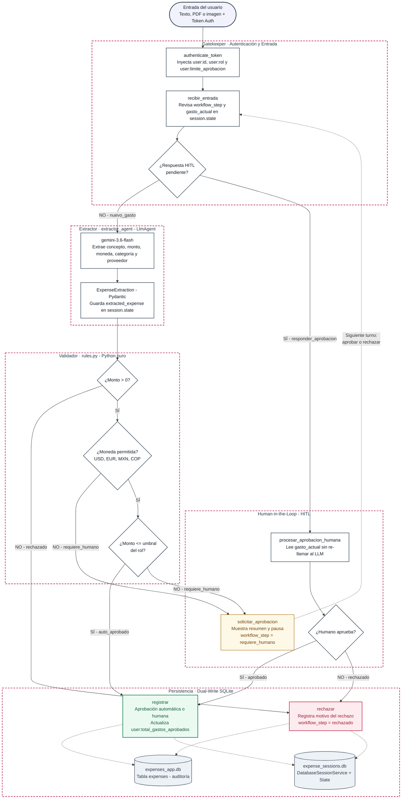

# Expense Approval Agent (Google ADK 2.0)

Agente de aprobación de gastos y contratos construido con **Google ADK 2.0**:
- **Extracción multimodal** (`extractor_agent`): lee texto, PDFs o imágenes de facturas/contratos con `output_schema` (Pydantic).
- **Validación determinista** (`rules.py`): reglas de negocio en Python puro (sin LLM) con límites por rol.
- **Human-in-the-Loop (HITL)**: montos pequeños se auto-aprueban; montos que superan el umbral pausan el flujo hasta confirmación humana.
- **Persistencia local** (`SQLite`): App DB (`expenses_app.db`) separada del estado de sesión (`DatabaseSessionService`).
- **Evaluación**: listo para `adk eval` (`expense_approval_agent/evals/`) y `agents-cli eval` (`tests/eval/`).

## Arquitectura



## Instalación

```bash
uv venv
uv pip install --only-binary cryptography -e .
```

Copia `.env.example` a `expense_approval_agent/.env` y agrega tu `GOOGLE_API_KEY`.

## Cómo ejecutar

### 1. Interfaz web (`adk web`)
```bash
.venv/bin/adk web
```
Abre `http://localhost:8000` y selecciona `expense_approval_agent`.

### 2. Ejecución por código con autenticación externa, SQLite y memoria
```bash
.venv/bin/python -m expense_approval_agent.run_with_persistence
```

### 3. Evaluación (`adk eval`)
```bash
.venv/bin/adk eval expense_approval_agent expense_approval_agent/evals/expense_approval.evalset.json \
  --config_file_path=expense_approval_agent/evals/eval_config.json \
  --print_detailed_results
```
