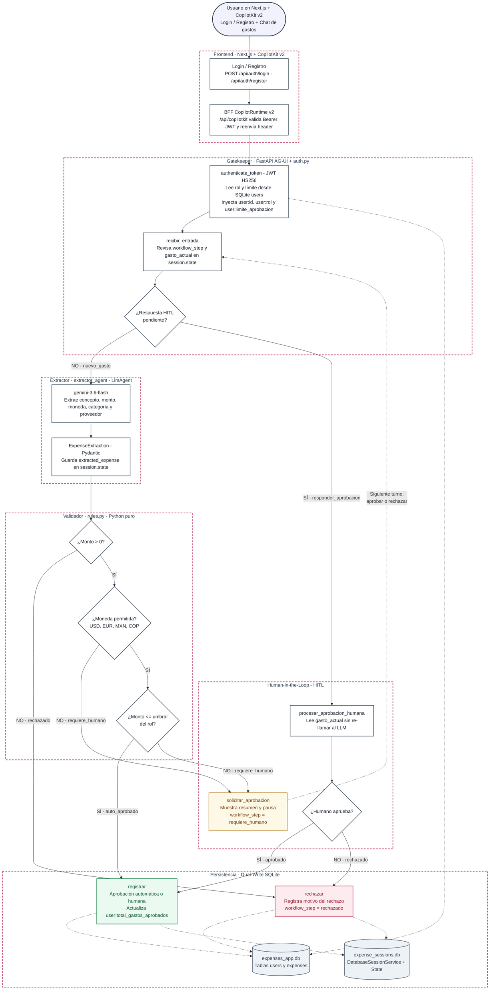

# Expense Approval Agent (Google ADK 2.0 + AG-UI + CopilotKit v2)

Agente multi-usuario de aprobación de gastos y contratos construido con **Google ADK 2.0**, protocolo **AG-UI** y frontend **Next.js + CopilotKit v2**:
- **Autenticación multi-usuario** (`auth.py` + `ag_ui_server.py`): registro y login real con contraseñas hasheadas (`scrypt`) en SQLite y tokens **JWT (HS256)** verificados antes de tocar el LLM.
- **Extracción multimodal** (`extractor_agent`): lee texto, PDFs o imágenes de facturas/contratos con `output_schema` (Pydantic).
- **Validación determinista** (`rules.py`): reglas de negocio en Python puro (sin LLM) con límites automáticos por rol (`empleado`, `gerente`, `director`).
- **Human-in-the-Loop (HITL)**: montos dentro del límite del rol se auto-aprueban; montos que superan el umbral pausan el flujo hasta confirmación humana.
- **Persistencia local** (`SQLite`): App DB (`expenses_app.db` con tablas `users` y `expenses`) separada del estado de sesión (`expense_sessions.db` vía `DatabaseSessionService`).
- **Frontend CopilotKit v2** (`frontend/`): app Next.js con pantalla de Login/Registro, BFF en `/api/copilotkit` y chat conectado vía AG-UI.
- **Evaluación**: listo para `adk eval` (`expense_approval_agent/evals/`) y `agents-cli eval` (`tests/eval/`).

## Arquitectura



## Instalación

### 1. Backend Python
```bash
uv venv
uv pip install --only-binary cryptography -e .
```

Copia `.env.example` a `expense_approval_agent/.env` (o `.env` en la raíz) y configura tus variables:
```env
GOOGLE_GENAI_USE_VERTEXAI=0
GOOGLE_API_KEY=tu_api_key_de_gemini
JWT_SECRET=clave_aleatoria_larga
```
Puedes generar `JWT_SECRET` con:
```bash
openssl rand -hex 32
```

### 2. Frontend Next.js (`frontend/`)
```bash
cd frontend
npm install
```

## Autenticación, Roles y Endpoints

La tabla `users` en `expense_approval_agent/expenses_app.db` almacena múltiples usuarios con contraseña hasheada (`scrypt`) y límite automático según el rol:

| Rol | Límite de auto-aprobación | Si el monto supera el límite |
| :--- | :--- | :--- |
| `empleado` | `<= 1,000` | Pausa HITL (`requiere_humano`) |
| `gerente` | `<= 5,000` | Pausa HITL (`requiere_humano`) |
| `director` | `<= 15,000` | Pausa HITL (`requiere_humano`) |

**Cuentas de prueba precargadas** (contraseña `demo1234`):
- `ana@empresa.com` (`empleado`, límite `<= 1,000`)
- `carlos@empresa.com` (`gerente`, límite `<= 5,000`)

**Endpoints expuestos por `ag_ui_server.py` (`http://localhost:8000`):**
- `POST /auth/register` — crea un usuario nuevo y devuelve `access_token` (JWT HS256).
- `POST /auth/login` — valida credenciales y devuelve `access_token` (JWT HS256).
- `GET /auth/me` — devuelve el perfil del usuario autenticado.
- `POST /` — endpoint AG-UI protegido con `Authorization: Bearer <jwt>` y `allow_scoped_state_keys=True`.
- `GET /health` — estado del servidor.

## Cómo ejecutar

### 1. App completa: Backend AG-UI + Frontend CopilotKit v2 (recomendado)

**Terminal 1 — Backend Python AG-UI (`http://localhost:8000`):**
```bash
.venv/bin/python -m expense_approval_agent.ag_ui_server
```

**Terminal 2 — Frontend Next.js (`http://localhost:3000`):**
```bash
cd frontend
npm run dev
```
Abre `http://localhost:3000`, inicia sesión con una cuenta precargada o crea una cuenta nueva desde la pestaña **Crear cuenta**.

### 2. Interfaz web de ADK (`adk web`)
```bash
.venv/bin/adk web
```
Abre `http://localhost:8000` y selecciona `expense_approval_agent`.

### 3. Ejecución por script con persistencia SQLite y memoria
```bash
.venv/bin/python -m expense_approval_agent.run_with_persistence
```

### 4. Evaluación (`adk eval`)
```bash
.venv/bin/adk eval expense_approval_agent expense_approval_agent/evals/expense_approval.evalset.json \
  --config_file_path=expense_approval_agent/evals/eval_config.json \
  --print_detailed_results
```
